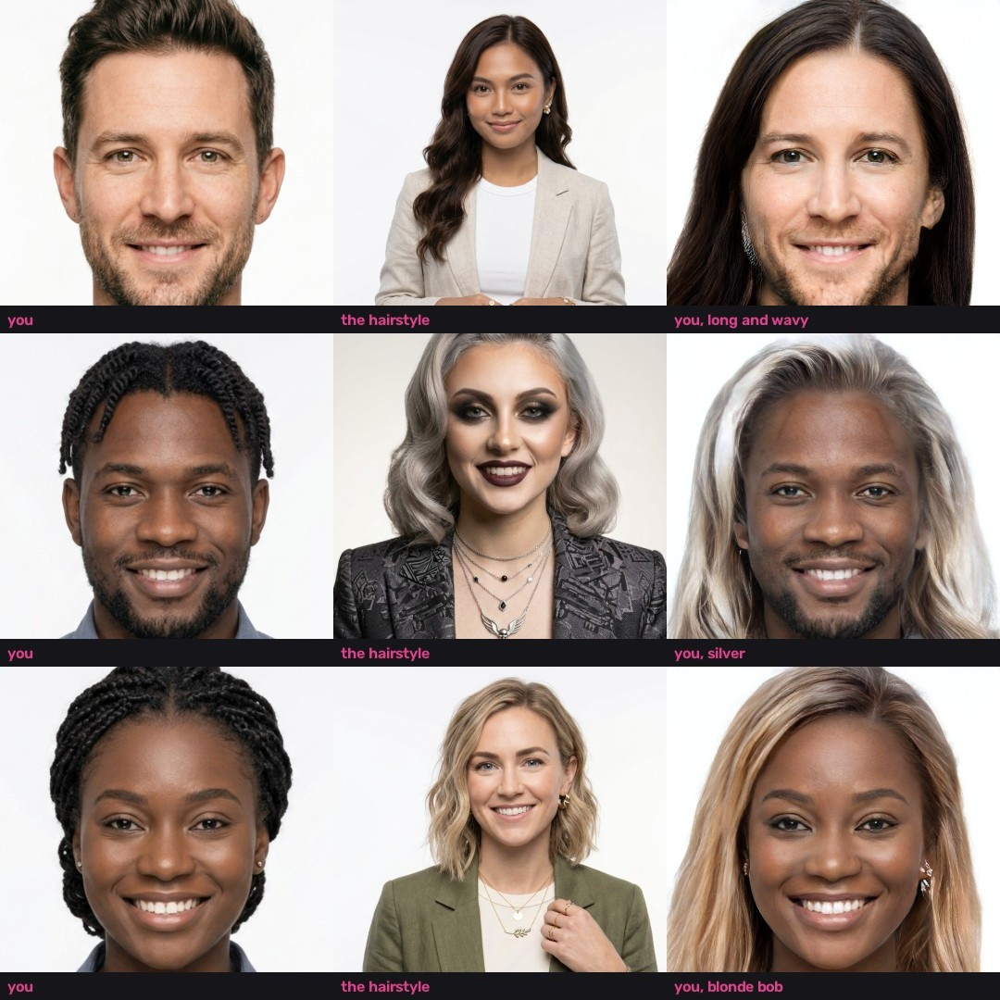
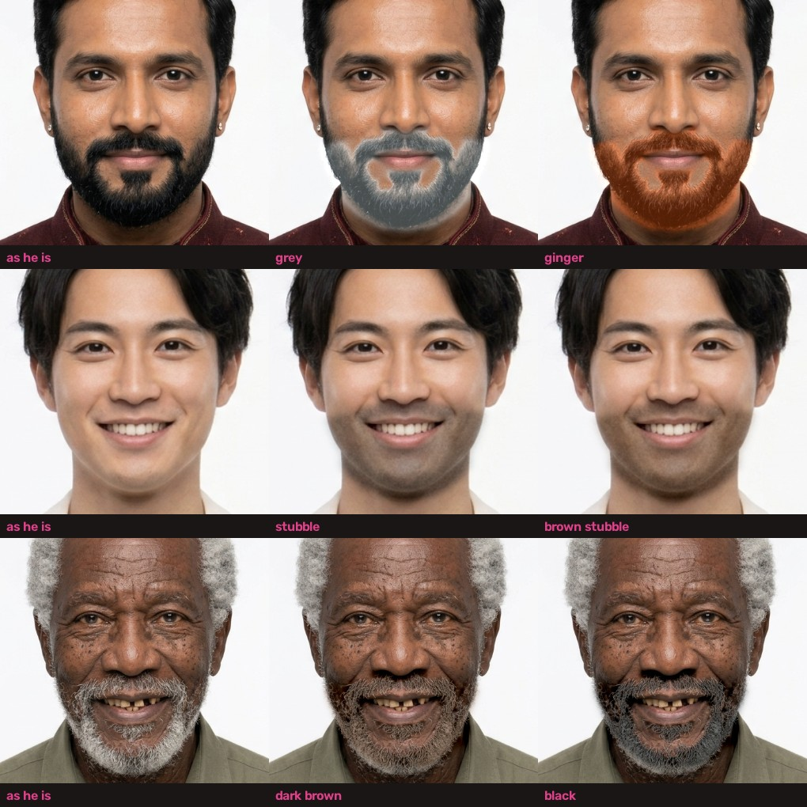
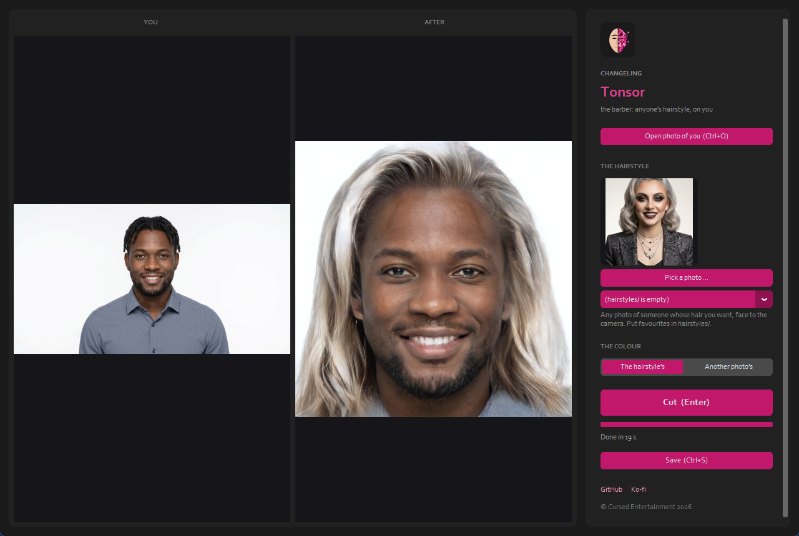

  

# Changeling Tonsor

**Website:** https://cursedprograms.github.io/Changeling-Tonsor/

Anyone's hairstyle on you, and your beard. A *tonsor* was a Roman barber (a *tonstrina* was his shop). Give Tonsor a photo of you and a photo of anyone
whose hair you want: their cut, length and parting, and its colour (or another photo's colour), on your own face.
Every face here is an AI-generated person who doesn't exist.

*Part of the Changeling family, all together in [Changeling Studio](https://github.com/CursedPrograms/Changeling-Studio):
[Simia](https://github.com/CursedPrograms/Changeling-Simia) ·
[Simia Realtime](https://github.com/CursedPrograms/Changeling-Simia-Realtime) ·
[Tiresias](https://github.com/CursedPrograms/Changeling-Tiresias) (gender) ·
[Chronos](https://github.com/CursedPrograms/Changeling-Chronos) (age) ·
[Natio](https://github.com/CursedPrograms/Changeling-Natio) (where in the world) ·
[Cosmeta](https://github.com/CursedPrograms/Changeling-Cosmeta) (makeup, hair, beards) ·
[Echo](https://github.com/CursedPrograms/Changeling-Echo) (voices) ·
**Tonsor** (hairstyles) ·
realtime: [Tiresias](https://github.com/CursedPrograms/Changeling-Tiresias-Realtime) ·
[Chronos](https://github.com/CursedPrograms/Changeling-Chronos-Realtime) ·
[Natio](https://github.com/CursedPrograms/Changeling-Natio-Realtime) ·
[Cosmeta](https://github.com/CursedPrograms/Changeling-Cosmeta-Realtime).*

## The beard

The barber does beards too (they moved here from Changeling Cosmeta):

- **Beard colour** (black to white, ginger, blonde), **Stubble** (painted in: a shadow of a beard) and **Shave** (the
  face's own skin back over stubble or a short beard), each with its strength. They work on the new hairstyle or on
  your photo as it is, and answer at once.
- **AI beards** (a full beard, a goatee, a moustache, clean shaven) through
  [AetherCanvas AI](https://github.com/CursedPrograms/AetherCanvas-AI) when it's running; **Undo the AI beard**.

How: dlib's 68 face points give the beard area (the jaw from cheek to cheek and a little past it, up to the
nostrils, without the lips), and BiSeNet keeps it off the background and clothes. Inside it, the beard is whatever
is clearly darker than the face's skin, or lighter and greyer (a white beard on darker skin). The colour is blended
in LAB, so each hair's light and shade stay. Both models come with HairFastGAN's, so the beard needs nothing extra.

## How it works

[HairFastGAN](https://github.com/AIRI-Institute/HairFastGAN) (AIRI Institute, NeurIPS 2024, MIT) does the work.
Each photo is found, aligned and cropped to the face as StyleGAN2's FFHQ faces are. It encodes the faces in
StyleGAN2's FS space, moves the hair's shape from one photo and its colour from the other onto yours, and blends.
Nothing is learned per photo: about 20 seconds a hairstyle on a 6 GB card, after about a minute of loading.
The result is the face frame, 1024 x 1024, as Changeling Tiresias's and Chronos's are.

What Tonsor adds:
- the window, in Changeling's look;
- `tonsor/patch_hairfast.py`, which makes HairFastGAN run anywhere. Its StyleGAN2 ops become plain PyTorch, so it
  needs no Visual Studio compiler or CUDA toolkit. CLIP goes in `F:\AIModels\clip`, and the models are read from
  where `tonsor/models.py` keeps them;
- `tonsor/models.py`, which fetches only the files hairstyle transfer needs (about 6 GB), into
  `F:\AIModels\HairFastGAN` when that drive is there. e4e is copied from Changeling Tiresias, Chronos or Natio
  rather than downloaded again.

## Use it

1. Python 3.9 - 3.12 and an NVIDIA GPU (6 GB works).
2. Start `run.bat` (or `run.ps1`, `run.sh`). The first time it clones HairFastGAN, makes its environment and
   fetches the models.
3. **Open photo of you**, then the hairstyle: **Pick a photo** of someone with it (face to the camera, the hair in
   view), or one from `hairstyles/` (put favourites there). **The colour:** the hairstyle's own, or **Another
   photo's**. Then **Cut** (Enter) and **Save**.

On the command line: `run.bat you.jpg hairstyle.jpg -o out.png` (`--colour other.jpg` for the colour).

## Its limits

- It knows the hair StyleGAN2 learned from FFHQ's photos. Long, short, wavy, straight, bobs and colours work well.
  Braids, beads, pigtails and other elaborate styles don't carry over: a goth's red braided pigtails came out as
  loose pinkish blonde hair.
- The result is the face frame, not the whole photo.
- Shave suits stubble and short beards; on a full beard it leaves a smudge: use the AI **Clean shaven** for that.
- Use it on yourself, on generated people, or on people who agreed.

## Licenses

Tonsor is MIT. HairFastGAN is MIT. Its StyleGAN2 FFHQ weights are under NVIDIA's non-commercial license, so this is
for personal and research use.

---

 

© Cursed Entertainment 2026

 

 

  

